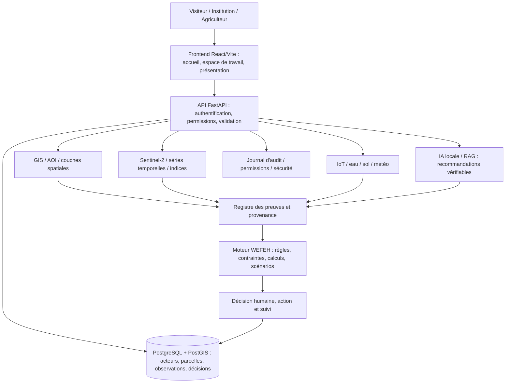

# FOGGARA-DZ — Architecture cible et nettoyage contrôlé

**Périmètre :** uniquement `skacimo1985-star/FOGGARA-PLATFORM-DZ`. Aucun autre dépôt ne doit être modifié. Ce document est un plan d'architecture, pas une déclaration de migration achevée.

## Flux fonctionnel



## Structure logique cible (pas une arborescence déjà migrée)

```text
FOGGARA-PLATFORM-DZ/
├── .github/workflows/        # CI/CD unique et vérifiable
├── app/
│   ├── src/
│   │   ├── App.tsx           # routeur unique
│   │   ├── pages/            # Landing, SourcePresentation, espaces de travail
│   │   ├── features/         # modules métiers, sans duplications
│   │   ├── components/       # composants réellement partagés
│   │   ├── context/          # session et authentification
│   │   └── lib/              # clients API, validation, calculs communs
│   ├── public/images/        # médias optimisés et sourcés
│   ├── backend/              # API, modèles, migrations et services
│   ├── tests/                # tests frontend et contrats
│   └── package.json
├── docs/                     # architecture, provenance, exploitation
└── [autres composants existants : moteurs, scripts, infra, tests]
```

## Contrat de consolidation

1. **Une seule présentation publique** : `/presentation` rend `SourcePresentation`; `/presentation-source` redirige vers `/presentation`. Pas de carousel historique intégré à Landing.
2. **Aucun CSS empilé pour masquer un défaut** : retirer les feuilles obsolètes seulement après recherche des imports et comparaison visuelle sur mobile/desktop.
3. **Ne pas effacer le métier** : préserver API, migrations, bases, preuves, calculs, télémétrie, GIS et services; ne supprimer aucune donnée.
4. **Distinguer** mesures observées, données vérifiées, calculs, inférences et propositions. Ne pas afficher de statistiques fictives comme données de production.
5. **Une source de vérité par responsabilité** : une route publique, un client API partagé, des contrats de données testés, une chaîne de provenance, des politiques d'accès.
6. **CI obligatoire avant fusion** : `npm ci`, `npm run build`, `npm run typecheck`, `npm run lint`, `npm test`; vérifier également les jobs backend, Rust, sécurité et conteneur.
7. **Pas de suppression massive** : inventorier les références des anciens fichiers (TSX/CSS/tests) avant de les retirer. Préserver l'historique Git. Pas de merge ni de déploiement si les contrôles échouent.

## État vérifié dans la branche de travail (2026-10-09)

- `App.tsx` utilise le chargement différé de `SourcePresentation`.
- `Landing.tsx` lie vers la nouvelle présentation.
- L'ancienne page `app/src/pages/Presentation.tsx` a été supprimée sur la branche de PR #198.
- Les feuilles historiques et certains composants hérités existent encore : leur suppression exige un audit des usages.
- La réussite du build, de tous les jobs CI et le déploiement **ne sont pas confirmés**.
